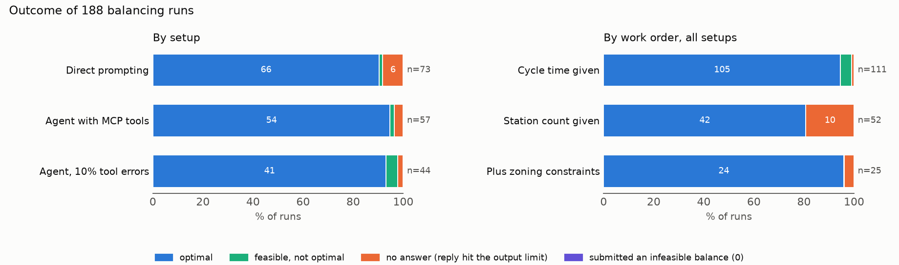

# mcp-linebal-eval

An LLM agent balances assembly lines through an [MCP](https://modelcontextprotocol.io) server, and every run is checked by code against the exact optimum from a CP-SAT solver.

## Results

DeepSeek-V4.1-Flash was tested in 196 runs on lines of 11 to 53 operations from the Scholl (1993) data sets.

When the model failed, it gave no answer rather than a wrong one. Of 188 runs that asked for a balance, 176 submitted a feasible balance and 171 of those were optimal. No run submitted a balance that broke a constraint, and every reported station count and cycle time matched the recomputed value. All 12 failures were replies cut off at the 32,768-token output limit while the model was still reasoning; 10 of them were work orders that fix the number of stations and ask for the shortest cycle time.

Working through the MCP tools, the agent checked its own balance before every one of its 113 submissions. An added verifier therefore had nothing to catch: it accepted all 10 submissions it checked.

Failing tools did not hurt either. When 10% of tool calls returned an error, the agent retried 30 of the 32 failed calls, and 43 of 44 runs still ended with a feasible balance.

| condition | runs | feasible | optimal | no answer | CNY / run |
|---|---|---|---|---|---|
| direct prompting | 73 | 91.8% | 90.4% | 6 | 0.05 |
| agent with MCP tools | 57 | 96.5% | 94.7% | 2 | 0.08 |
| with 10% tool errors | 44 | 97.7% | 93.2% | 1 | 0.07 |
| agent with verifier (pilot) | 8 | 6 / 8 | 6 / 8 | 2 | 0.15 |

Giving the model tools did not measurably change the success rate. On the 18 tasks run both ways, the agent with tools scored 1.4 percentage points higher than direct prompting (95% CI −3.2 to +6.5), and each run cost about 1.5 times as much. Full tables are in [`results/tables/`](results/tables/).

AssemPlanner (Zhang et al. 2026, arXiv:2605.08831) reports a cycle time of 247 s for its 12-operation valve line on 5 stations. The CP-SAT solver proves in 0.04 s that the optimum is 240 s. On the Scholl data it proves the optimum of 170 of 174 instances within 60 s, each equal to the published value.
